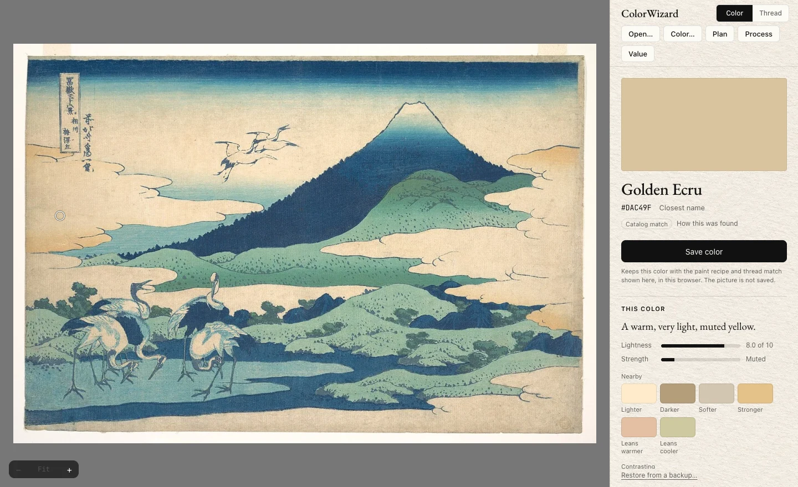
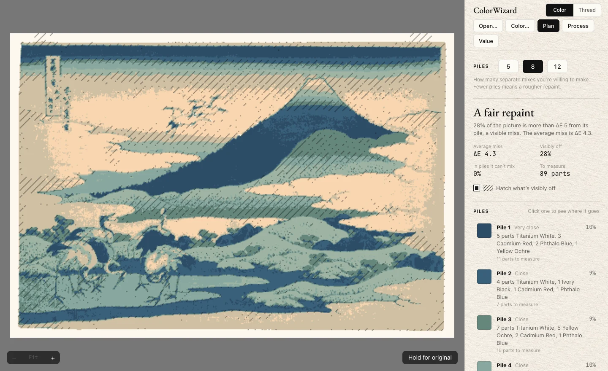
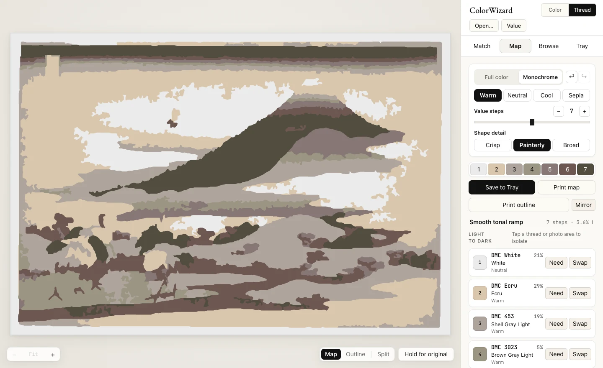

# ColorWizard

**A color reference tool for painters and embroiderers.** Open a picture, sample a color, and see how you might mix it in paint or match it to DMC embroidery floss. Work one color at a time or plan a palette for the whole picture.

[**Open ColorWizard**](https://colorwizard.app/) · [DMC Thread Studio](https://colorwizard.app/thread) · [Workbench](https://colorwizard.app/workbench)



## Try it

1. Choose **Try a demo picture** to open Hokusai’s *Umezawa Manor* with a color already selected, or choose **Open…** to use your own reference. You can also drag in or paste an image.
2. Click or tap the picture to sample a color. Use the loupe for detail, switch on **Value** to see the picture in grayscale, or use **Type a color** to start with a hex code.
3. Explore the color’s lightness, chroma, temperature, and relationships. Scroll to **Paint** or **Thread** for a material match, or **Save color** to keep it for later.

Reference images are processed on your device. The web app requires no account or image upload. Saved colors, notes, collections, and attached paint and thread results stay in the current browser profile. You can download a JSON backup and restore it in another browser.

## Painting

- **Mix a color.** Get a spectral paint recipe using the default six pigments or a palette you choose. Compare the target with the predicted mix and see the proportions in whole parts where the model finds a simple ratio.
- **Plan the whole picture.** Choose a budget of 5, 8, or 12 paint piles. See where each numbered mix goes, compare the preview with the reference, print a recipe card, or export a Procreate-format `.swatches` palette.
- **Develop the underpainting.** Step through a toned ground, a lay-in, three-value masses, and a six-value brunaille, with guidance on what to mix and what to check at each stage.



Paint recipes are model-based starting points. Pigment strength, paint brand, surface, and lighting affect the physical result. The on-screen fit compares the reference with the model’s predicted color.

## Embroidery

- **Match and browse DMC floss.** Find the closest catalog shades, compare light-to-dark families, and look for intermediate shades between two skeins.
- **Make a Thread Map.** Turn a reference into numbered stitch regions using 2–30 threads in full color or 2–12 in monochrome. Isolate a thread’s regions, preview substitutions in place, and print a color map or a fabric-transfer outline.
- **Build a Skein Tray.** Save a thread selection, check value gaps, mark the skeins you own, and export a shopping list.



DMC matches use catalog colors estimated from product photography. Lighting and the physical skein can affect how a shade looks.

## Workbench and macOS

The [browser workbench](https://colorwizard.app/workbench) adds a paint library, palette tools, canvas overlays, and stitch planning. The Tauri app opens this workspace with a local project gallery.

The April 2026 [macOS release](https://github.com/coltonbatts/colorwizard/releases/tag/v1.0.0) provides an Apple Silicon DMG. Use the web app for the newer workflows shown above.

## Run from source

Use Node.js 20, the version pinned in [`.nvmrc`](.nvmrc) and used in CI.

```sh
git clone https://github.com/coltonbatts/colorwizard.git
cd colorwizard
npm ci
npm run dev
```

Open [localhost:3000](http://localhost:3000). No environment variables are required. The dev and build commands generate the local DMC and color-name data automatically.

```sh
npm run lint
npm run typecheck
npm test -- --run
npm run validate:paints
npm run build
```

The production build generates a static site in `out/`. The web app uses Next.js, React, TypeScript, Zustand, and Canvas. Web Workers handle heavier calculations, and paint predictions use Spectral.js.

On macOS, install the [Tauri prerequisites](https://v2.tauri.app/start/prerequisites/) before running the desktop commands. Tauri builds and bundles the static frontend automatically.

```sh
npm run tauri:dev
npm run tauri:build:dmg
```

## Further reading

- [Paint recipe accuracy audit](docs/paint-accuracy-audit.md)
- [Whole-picture paint planning audit](docs/paint-plan-audit.md)
- [Painting Process design notes](docs/painting-process.md)

## Contributing

Report bugs or propose improvements in [GitHub Issues](https://github.com/coltonbatts/colorwizard/issues). For a bug, include the workflow, browser or app version, and steps to reproduce it.

## Credits

The demo artwork is Katsushika Hokusai’s public-domain *Umezawa Manor in Sagami Province*, from [The Metropolitan Museum of Art](https://www.metmuseum.org/art/collection/search/55738).
